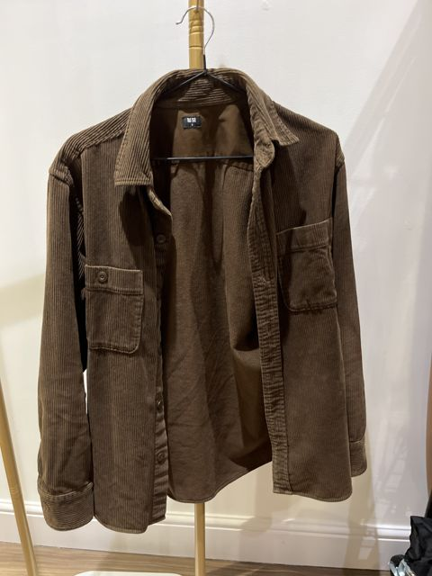
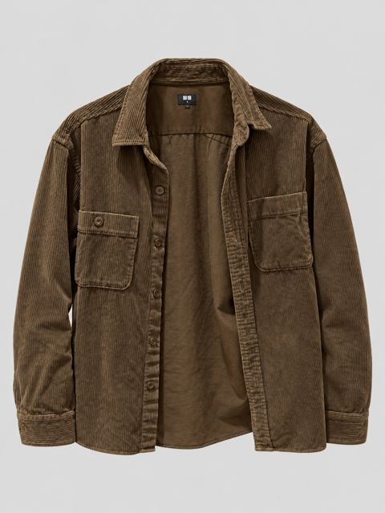
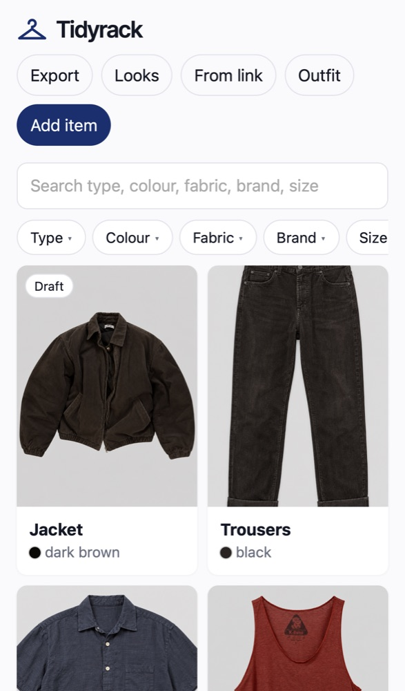
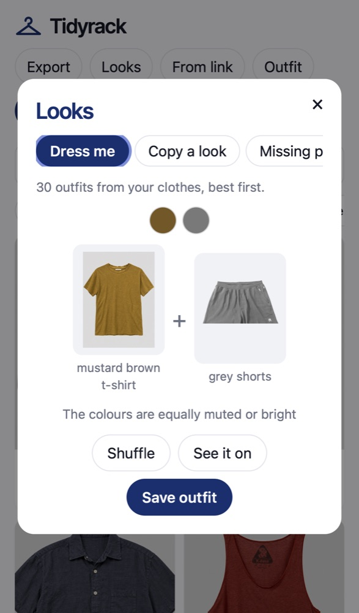

# Tidyrack

Photograph your clothes on your phone. Tidyrack cuts each one out, redraws it as a clean catalogue shot and reads the label.

<p>
  
  
</p>

<p>
  
  
</p>

- **Sell on Vinted**: writes the listing and shares the real photos.
- **Looks**: outfits from what you own, and the one piece you're missing.
- **What if I…**: see a garment dyed, faded or cut before you change it.
- **From link** and **Outfit**: add clothes from a shop page or a mirror selfie.
- **Export**: everything in one zip.

## Run it

You need a Mac, [uv](https://docs.astral.sh/uv/) and the [Codex CLI](https://github.com/openai/codex) signed in to a paid ChatGPT plan.

```bash
./run.sh install   # starts at login, at http://127.0.0.1:8760
./run.sh phone     # open it on your phone with Tailscale
```

Or point Codex or Claude Code at this repo: [AGENTS.md](AGENTS.md) walks it through the setup. Everything else is in the [guide](GUIDE.md).

Prefer not to run it yourself? [tidyrack.simonwisdom.com](https://tidyrack.simonwisdom.com) is a hosted copy that runs on your own OpenRouter key.

No support: issues are off. Fork it and make it yours.

## License

[MIT](LICENSE). The Inter Tight font is under the [SIL Open Font License](static/fonts/OFL.txt).
