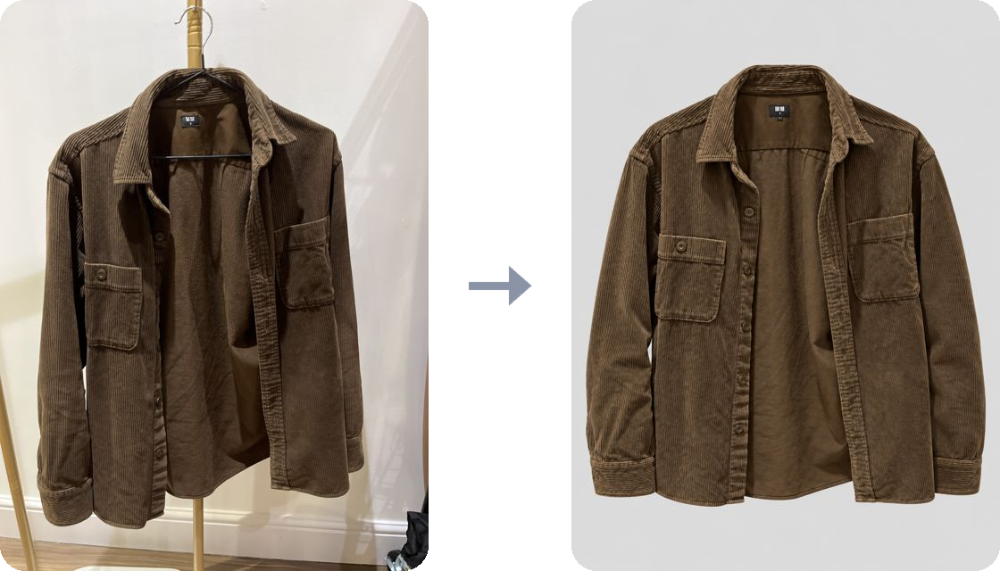

<p align="center">
  
</p>

<h1 align="center">Tidyrack</h1>

<p align="center">
  <b>Your whole wardrobe, photographed once and tidied for good.</b><br>
  Snap a shirt on your phone. Tidyrack cuts it out, redraws it as a catalogue shot and reads the label.
</p>

<p align="center">
  <a href="LICENSE"></a>
  <a href="https://github.com/simonwisdom/tidyrack/actions/workflows/test.yml"></a>
  
</p>

<p align="center">
  
</p>

<p align="center">
  
  &nbsp;
  
</p>

## What it does

- 🏷️ **Sell on Vinted**: writes the listing and shares the real photos.
- 👗 **Looks**: outfits from what you own, plus the one piece you're missing.
- 🎨 **What if I…**: see a garment dyed, faded or cut before you touch it.
- 🔗 **From link** and 🤳 **Outfit**: add clothes from a shop page or a mirror selfie.
- 📦 **Export**: everything in one zip. It's your data.

## Run it

You need a Mac, [uv](https://docs.astral.sh/uv/) and the [Codex CLI](https://github.com/openai/codex) signed in to a paid ChatGPT plan.

```bash
./run.sh install   # starts at login, at http://127.0.0.1:8760
./run.sh phone     # open it on your phone with Tailscale
```

🤖 Or hand this repo to Codex or Claude Code: [AGENTS.md](AGENTS.md) walks it through the setup. Everything else is in the [guide](GUIDE.md).

☁️ Rather not run it yourself? [tidyrack.simonwisdom.com](https://tidyrack.simonwisdom.com) is a hosted copy that runs on your own OpenRouter key.

## No support, all yours

Issues are off. Fork it, change it, make it yours.

[MIT](LICENSE). The Inter Tight font is under the [SIL Open Font License](static/fonts/OFL.txt).
